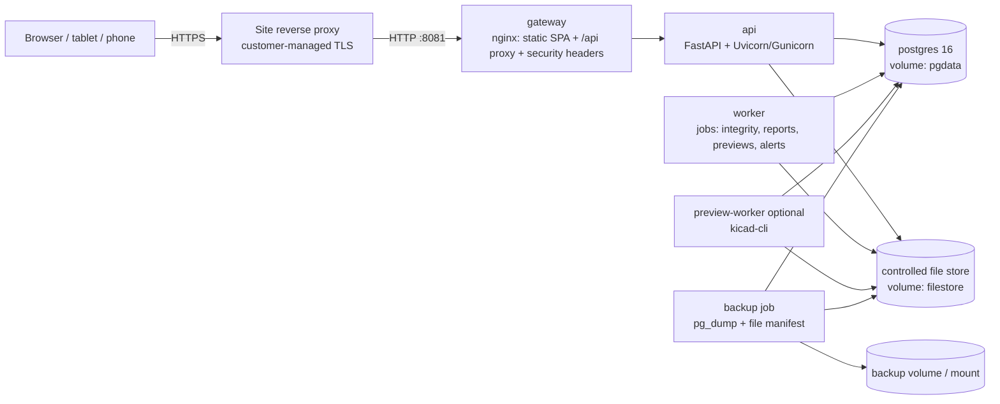

# 02 — System Architecture

## 1. Container topology



| Container | Image | Purpose | Exposed |
|-----------|-------|---------|---------|
| `gateway` | nginx (pinned digest) | Serves built React SPA, proxies `/api`, applies headers, request size limits | `8081` (host) |
| `api` | python:3.12-slim | REST API, auth, business services | internal only |
| `worker` | same image as api | Postgres-queue jobs | none |
| `preview-worker` | api image + KiCad CLI (optional profile) | Symbol/footprint SVG rendering | none |
| `db` | postgres:16 (pinned) | System of record | none (internal network) |
| `backup` | api image, run on schedule/manually | Consistent backup sets | none |

Production: TLS terminated at a customer reverse proxy (or an optional Caddy/nginx TLS profile). The app trusts `X-Forwarded-*` only from configured proxy addresses.

## 2. Technology stack

| Layer | Choice | Rationale |
|-------|--------|-----------|
| Frontend | React 18, TypeScript (strict), Vite | As specified |
| UI kit | **Mantine v7** | Mature, accessible, dense enterprise layouts, no licence issues |
| Tables | TanStack Table (server-side sort/filter/paging) | Large datasets |
| Data fetching | TanStack Query | Caching, invalidation, optimistic UI disabled for controlled actions |
| Forms | react-hook-form + zod | Client validation mirroring server |
| API client | Generated from OpenAPI (`openapi-typescript`) | Typed contract, no drift |
| 3D preview | three.js + `occt-import-js` (WASM) for STEP, VRMLLoader for WRL | Client-side, no server CAD kernel |
| PDF preview | pdf.js | Standard |
| Backend | Python 3.12, FastAPI, Pydantic v2 | As specified |
| ORM | SQLAlchemy 2.0 (sync), psycopg 3 | See challenge C13 |
| Migrations | Alembic, hand-reviewed; no `create_all` outside tests | §31 |
| Password hashing | Argon2id (`argon2-cffi`) | Current best practice |
| MFA | TOTP (`pyotp`), optional per user/role | Signing roles recommended to require it |
| QR | `segno` | Pure Python, no deps |
| PDF reports/labels | WeasyPrint (HTML → PDF) | Templated, reproducible |
| MIME sniffing | `python-magic` (libmagic) | Upload validation |
| Search | PostgreSQL FTS + `pg_trgm` | No extra service to validate |
| Hierarchy | `ltree` extension | Location subtree queries |
| Logging | structlog JSON → stdout | Collected by host |
| Tests | pytest, testcontainers-postgres, Playwright (E2E) | Real Postgres for constraint/locking tests |

## 3. Backend layering

```
backend/app/
  core/          config, logging, security primitives, clock, errors
  db/            engine, session, roles, base model, triggers (SQL)
  models/        SQLAlchemy models, one module per bounded context
  schemas/       Pydantic request/response models
  domain/        state machines, revision rules, pure business rules (no I/O)
  services/      transactional use-cases; ONLY layer that writes
    audit.py     append-only audit writer (same transaction as change)
    signatures.py
    files.py     storage abstraction + hashing
    inventory.py ledger posting with row locks
    ...
  api/routes/    thin HTTP handlers: authN → authZ → service call
  auth/          sessions, CSRF, password, MFA, re-auth
  permissions/   permission registry, policy checks, signing authority
  jobs/          worker job handlers
  storage/       LocalFileStore, (future) S3Store implementing FileStore protocol
tests/ unit | api | permissions | workflow | inventory | bom | audit | files | migrations
alembic/
```

Rules enforced by review and lint (import-linter):

- Routes never touch the ORM session directly for writes.
- Every write service takes an `ActorContext` (user, session, IP, request id, reason) — no anonymous writes possible.
- Every write service writes its audit event(s) in the same DB transaction.
- No bulk `UPDATE`/`DELETE` on controlled tables (bypasses audit); enforced additionally by DB triggers.

## 4. Request lifecycle (controlled action)

1. Gateway: size limit, headers.
2. Session cookie → session row (not expired, not revoked, idle timeout) → user.
3. CSRF token check for unsafe methods.
4. Permission check (server-side, `require("bom:release")`).
5. For signatures: re-authentication (password [+ TOTP]) in the same request, signing-authority check, separation-of-duties check.
6. Service: `BEGIN` → lock rows → validate state transition → write → audit → search index update → `COMMIT`.
7. Response includes new version token (optimistic concurrency via `row_version` on editable drafts).

## 5. Configuration

All via environment variables (`.env`, never committed). Categories: DB DSNs per role (`APP_DB_URL`, `MIGRATOR_DB_URL`), secret key, session lifetimes, upload max size, allowed extensions per document class, trusted proxies, time zone, feature flags (MFA required for signers, download auditing), storage backend. Runtime-editable *business* settings (numbering formats, signature rules, retention) live in the DB, are versioned and audited as configuration changes.

## 6. Versioning

- App version: SemVer from git tag, injected at build (`APP_VERSION`, `GIT_COMMIT`, `BUILD_TIME`).
- Schema version: Alembic head, checked at startup — **api refuses to start if DB schema ≠ expected head** (prevents running unvalidated combinations).
- `/api/health` (liveness), `/api/ready` (DB + storage + schema match), `/api/version`.
- `CHANGELOG.md` + in-app release history page.

## 7. Future S3 path

`FileStore` protocol: `put(stream) -> (key, sha256, size)`, `open(key)`, `exists(key)`, `stat(key)`. Local implementation is content-addressed and write-once. An S3 implementation with Object Lock (compliance mode) slots in without schema change (`storage_backend`, `storage_key` columns already present).
