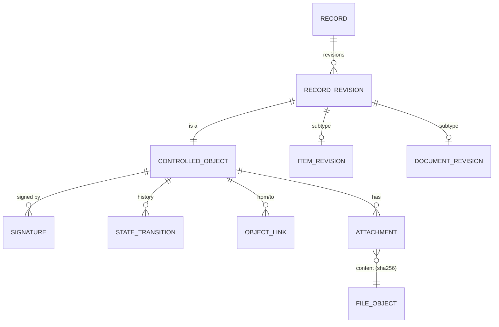

# 03 — Database and Entity Model

PostgreSQL 16. Extensions: `pgcrypto`, `pg_trgm`, `ltree`, `citext`.
Conventions: `uuid` PKs (`gen_random_uuid()`), except the ledger and audit tables (`bigint identity`, strict ordering). All timestamps `timestamptz`, set by the DB (`clock_timestamp()`), never by the client. Monetary/quantity values `NUMERIC`, never float. Enums as PostgreSQL `CHECK` constraints on `text` (easier to migrate than native enums).

## 1. Core pattern: controlled objects

Every object that can be signed, state-transitioned or referenced by change control has a row in a supertype table. This gives real foreign keys for signatures, links and ECO affected items instead of polymorphic `(type, id)` pairs.

| Table | Key columns | Constraints / notes |
|-------|-------------|---------------------|
| `controlled_object` | id, object_type, status, created_at, created_by, row_version | status validated per type by trigger + service |
| `record` | id, record_type, number, current_released_revision_id | UNIQUE(record_type, number) — master identity (item, document) |
| `record_revision` | id → controlled_object.id, record_id, revision_label, iteration, content_hash, supersedes_id, released_at | UNIQUE(record_id, revision_label) where label not null; partial UNIQUE: ≤1 revision per record in (Draft, Under Review) |
| `signature` | id, object_id, meaning, signer_id, signer_printed_name, signed_at, content_hash, auth_method, comment | UNIQUE(object_id, meaning, signer_id); insert-only (trigger) |
| `state_transition` | id, object_id, from_status, to_status, actor_id, at, reason, signature_id | insert-only |
| `approval_rule` | object_type, transition, meaning, min_signers, author_may_sign | configuration, versioned + audited |
| `object_link` | from_object_id, to_object_id, link_type (satisfies, verifies, specifies, datasheet_of, risk_ref…) | UNIQUE(from, to, type) |
| `number_sequence` | code, format, next_value | allocated under `FOR UPDATE` |

**Immutability enforcement (defence in depth):**
1. Service layer rejects edits unless status ∈ {Draft}.
2. Trigger on every `*_revision` subtype table: `BEFORE UPDATE/DELETE` raises if the parent `controlled_object.status` is not Draft.
3. `content_hash` = SHA-256 of canonical JSON of the revision's controlled content (fields + BOM lines + attachment hashes), computed at submit-for-review and re-verified at every signature. A signature stores the hash it signed; any mismatch blocks signing and is detectable later.

## 2. Identity, access

| Table | Key columns | Notes |
|-------|-------------|-------|
| `app_user` | id, username (citext unique), full_name, email, password_hash, is_active, mfa_secret_enc, password_changed_at, failed_attempts, locked_until | never deleted; deactivated |
| `role` | id, code unique, name, is_system | |
| `permission` | code PK (`bom:release`) | seeded from code registry |
| `role_permission` | role_id, permission_code | PK both |
| `user_role` | id, user_id, role_id, granted_by, granted_at, revoked_at, revoked_by | history retained; active = revoked_at null |
| `signing_authority` | id, user_id, meaning, scope_type, scope_value, granted_by, granted_at, revoked_at | separate from roles (see doc 04) |
| `session` | id, token_hash, user_id, created_at, last_seen_at, expires_at, ip, user_agent, revoked_at | token stored hashed |
| `system_setting` | key, value, version, updated_by, updated_at | changes audited |

## 3. Items (part master, PCBs, assemblies, products)

| Table | Key columns | Constraints |
|-------|-------------|-------------|
| `item` (subtype of record) | record_id, item_class, uom | class ∈ component, bare_pcb, pcba, mechanical, cable, firmware, assembly, product, kit |
| `item_revision` | revision_id, description, category_id, internal_lifecycle, notes, change_reason | lifecycle ∈ Draft, Under Review, Approved, Released, NRND, Obsolete, Prohibited, Discarded |
| `component_attrs` | revision_id, component_type, value, package, rohs_status, reach_status, msl (nullable) | 1:1 with component revisions |
| `product_attrs` | revision_id, product_family_id, regulatory_class, intended_use_ref, udi_di | 1:1 with product revisions |
| `item_category` | id, parent_id, code, name, pn_prefix | |
| `manufacturer` | id, name citext unique, website | |
| `manufacturer_part` | id, manufacturer_id, mpn, mfr_lifecycle, datasheet_url, rohs, reach, country_of_origin | UNIQUE(manufacturer_id, mpn) |
| `aml_entry` (controlled_object) | id, item_id, manufacturer_part_id, preference_rank, qualification_status, notes | UNIQUE(item_id, manufacturer_part_id); status Proposed → Approved → Disqualified; approvals via `signature`; evidence via `object_link` to documents |
| `item_cad_binding` | item_revision_id, document_id, asset_role, document_revision_id | asset_role ∈ symbol, footprint, model_3d, sim_model; revision pinned at item release |

Lifecycle note: *manufacturer* lifecycle (Active/NRND/EOL/Obsolete) is data about the MPN; *internal* lifecycle is the controlled state of our part. They are separate columns and are not synchronised automatically.

## 4. Documents and CAD (unified)

CAD assets are controlled documents of a CAD document class. One revision/approval engine for everything.

| Table | Key columns | Notes |
|-------|-------------|-------|
| `document` (record) | record_id, document_class_id, owner_id | |
| `document_class` | id, code, name, allowed_extensions, requires_effective_date, audit_downloads | e.g. SOP, SPEC, DWG, KICAD_SYM, KICAD_FP, MODEL_3D, DATASHEET, COC, QUAL, DECL |
| `document_revision` | revision_id, title, author_id, change_description, effective_date | lifecycle Draft → Under Review → Approved → Effective → Superseded / Obsolete |
| `file_object` | id, sha256 UNIQUE, size_bytes, mime_detected, storage_backend, storage_key, stored_at, last_verified_at, last_verify_result | content-addressed, write-once |
| `attachment` | id, object_id, file_object_id, original_filename, safe_filename, role, uploaded_by, uploaded_at | a locked object's attachments are immutable (trigger) |
| `preview` | source_file_object_id, kind, preview_file_object_id, generator_version | derived, non-controlled, regenerable |

## 5. Suppliers and purchasing

| Table | Key columns | Constraints |
|-------|-------------|-------------|
| `supplier` | id, code unique, name, category, address, contacts (child table), website, is_active | |
| `supplier_approval` (controlled_object) | id, supplier_id, scope, risk_class, approval_state, valid_from, re_evaluation_due | append-only history; current = latest effective |
| `supplier_evaluation` | id, supplier_id, performed_at, performed_by, result, document_id | |
| `supplier_part` | id, supplier_id, manufacturer_part_id, supplier_pn, pack_qty, stock_uom_factor, moq, lead_time_days | UNIQUE(supplier_id, supplier_pn) |
| `price_record` | id, supplier_part_id, currency CHAR(3), qty_break, unit_price, source (quote, po, manual), source_ref, valid_from, valid_to, created_by | CHECK unit_price ≥ 0, currency ~ '^[A-Z]{3}$' |
| `purchase_order` (controlled_object) | id, po_number unique, supplier_id, currency, amendment_no, status | Draft → Review → Approved → Ordered → Partially Received → Received → Closed / Cancelled |
| `po_line` | id, po_id, line_no, item_id, manufacturer_part_id, supplier_part_id, qty, unit_price, expected_date, cancelled_qty | UNIQUE(po_id, line_no); editable only in Draft; amendment after approval → `po_amendment` (diff, reason) + return to Review |
| `receipt` | id, receipt_no, po_id, received_at, received_by, delivery_ref | |
| `receipt_line` | id, receipt_id, po_line_id, qty_received, lot_id | Σ receipt ≤ ordered + configured over-receipt tolerance |
| `incoming_inspection` (controlled_object) | id, lot_id, inspection_plan_doc_rev_id, result, inspected_by, inspected_at | signature meaning "Material Released" |

Rule: PO approval requires the supplier to have a current Approved `supplier_approval` covering the item category, and each line's MPN to be on an Approved AML entry (configurable warning vs block).

## 6. Locations and inventory

| Table | Key columns | Constraints |
|-------|-------------|-------------|
| `location` | id, parent_id, kind, code unique, name, path ltree, is_quarantine, is_active, qr_token unique | kind order site > room > cabinet > drawer > bin > compartment enforced by trigger |
| `inventory_lot` | id, lot_no unique, item_id, item_revision_id (at receipt), manufacturer_part_id, supplier_id, supplier_part_id, receipt_line_id, parent_lot_id, supplier_lot, mfr_lot, date_code, qty_received, uom, received_at, received_by, expiry_date, lot_status | status ∈ Pending Inspection, Available, Quarantined, Depleted, Scrapped, Returned; provenance columns immutable after creation (trigger) |
| `lot_balance` | lot_id, location_id, qty_on_hand, qty_reserved | PK(lot_id, location_id); CHECK on_hand ≥ 0, reserved ≥ 0, reserved ≤ on_hand |
| `stock_txn` | id bigint, txn_uuid, correlation_id, txn_type, occurred_at, actor_id, lot_id, item_id, location_id, d_on_hand, d_reserved, on_hand_before, on_hand_after, reserved_before, reserved_after, reason_code, comment, po_line_id, build_id, ncr_id, reverses_txn_id | insert-only; CHECK after = before + delta for both dimensions |
| `allocation` | id, build_id, bom_line_ref, item_id, lot_id NULL, location_id NULL, qty, kind (soft/hard), status | hard allocations mirrored into `lot_balance.qty_reserved` via ledger |

Transaction types: RECEIPT, ISSUE, RESERVE, RESERVE_RELEASE, BUILD_CONSUME, RETURN, TRANSFER (two legs, shared correlation_id), ADJUST, SCRAP, SPLIT, QUARANTINE, QUARANTINE_RELEASE, RETURN_TO_SUPPLIER, REVERSAL.

Concurrency: posting locks the affected `lot_balance` rows in a deterministic order (lot_id, location_id) to avoid deadlocks, then inserts ledger rows. Negative stock is impossible at the constraint level, not just in code.

Allocation eligibility (computed, not stored): lot_status = Available ∧ inspection accepted ∧ not expired ∧ item revision not Prohibited ∧ MPN on approved AML (∧ within BOM line restriction) ∧ location not quarantine.

## 7. BOMs

| Table | Key columns | Constraints |
|-------|-------------|-------------|
| `bom_line` | id, parent_revision_id (assembly-class item_revision), line_no, child_item_id, qty, uom, dnp, notes | UNIQUE(parent_revision_id, line_no); CHECK qty > 0; locked with parent |
| `bom_line_refdes` | bom_line_id, parent_revision_id, refdes | UNIQUE(parent_revision_id, refdes) — duplicate designators impossible |
| `bom_line_aml_restriction` | bom_line_id, aml_entry_id | optional subset of approved alternates |
| `bom_import` | id, target_revision_id, source_attachment_id, parsed (jsonb), diff (jsonb), status, committed_at | staging only — JSON acceptable, not controlled data |

Release checks: every child has a released, non-prohibited revision; pcs-UoM lines with refdes have qty = count(refdes) (unless override with reason); no cycles (recursive CTE check).

## 8. Manufacturing

| Table | Key columns | Constraints |
|-------|-------------|-------------|
| `build` (controlled_object) | id, build_no unique, item_revision_id (Released), qty_planned, qty_completed, qty_approved_for_distribution, planned_date, status | Planned → Kitted → In Progress → Completed → Released → Closed / Cancelled |
| `build_config` | build_id, path ltree, item_id, item_revision_id, qty_per | frozen as-planned configuration at creation |
| `unit` (controlled_object) | id, serial_no unique, item_revision_id, build_id, manufactured_at, udi_pi, parent_unit_id, status | Manufactured, Testing, Released, Quarantined, Reworked, Scrapped, Returned |
| `unit_component` | unit_id, lot_id NULL, child_unit_id NULL, refdes NULL, qty | CHECK exactly one of lot/child_unit; per-unit genealogy (optional per product) |
| `test_record` | id, unit_id / build_id, procedure_doc_rev_id, result, performed_by, performed_at, attachment | |

Build-level genealogy = `stock_txn` rows with `build_id` (issued lots). "Where used" = recursive query: lot → split children → txns → builds → units → parent units.

## 9. Quality and change control

| Table | Key columns |
|-------|-------------|
| `ncr` (controlled_object) | id, ncr_no, external_ref, description, detected_at, detected_by, disposition, justification, concession_ref |
| `ncr_subject` | ncr_id, lot_id / unit_id / build_id, qty |
| `ecr` (controlled_object) | id, ecr_no, title, reason, description, requested_by, source_ref (NCR/CAPA/complaint id) |
| `eco` (controlled_object) | id, eco_no, description, risk_assessment_link, verification_required, verification_ref, validation_required, validation_ref, implementation_plan, effective_date |
| `eco_ecr` | eco_id, ecr_id |
| `eco_affected` | eco_id, record_id, from_revision_id, to_revision_id, stock_disposition, wip_disposition, field_disposition |

Rule: releasing a revision of a record that already has a released revision requires an Approved ECO listing it in `eco_affected`. ECO → Implemented automatically when all `to_revision`s are released.

## 10. Audit, search, jobs

| Table | Key columns | Notes |
|-------|-------------|-------|
| `audit_event` | id bigint, event_uuid, occurred_at, actor_id, actor_username, session_id, ip, user_agent, request_id, action, entity_type, entity_id, entity_label, object_id, before jsonb, after jsonb, reason, prev_hash, hash | insert-only, hash-chained (doc 05) |
| `search_entry` | object_type, object_id, label, body tsvector, trigram_text | GIN indexes; maintained in the writing transaction |
| `job` | id, type, payload, status, run_after, attempts, locked_by, locked_at, result | `FOR UPDATE SKIP LOCKED` |
| `integrity_run` / `integrity_finding` | run metadata / missing, size-mismatch, hash-mismatch, orphan | |

## 11. Database roles (least privilege)

| Role | Rights |
|------|--------|
| `qplm_owner` | owns schema; used only by Alembic migrations |
| `qplm_app` | SELECT/INSERT/UPDATE on business tables; INSERT/SELECT only on `audit_event`, `stock_txn`, `signature`, `state_transition`; no DDL; no DELETE on any controlled table |
| `qplm_readonly` | SELECT on reporting views (KiCad DB library, BI) |
| `qplm_backup` | pg_dump rights |

Triggers raise on UPDATE/DELETE of insert-only tables regardless of role; only the owner could drop them, and that is a schema change visible in migrations and the audit hash chain gap check.

## 0.2 procurement-to-production traceability additions

The 0.2 schema adds `supplier`, `purchase_order`/`purchase_order_line`, `goods_receipt`/`goods_receipt_line`, `bom`/`bom_revision`/`bom_line`, `production_build`, `build_material`, and `finished_serial`.

The genealogy spine is deliberately relational: **Supplier → PO line → Goods receipt → Inventory lot → Build material → Production build → Finished serial**. A build references exactly one released BOM revision; every build-material row references the exact BOM line, lot, location and append-only stock transaction that performed the issue. Released BOMs, released builds and released serial records are database guarded against update/delete. Legacy 0.1 free-text receipt provenance remains readable; controlled 0.2 receipts use foreign-key records.
