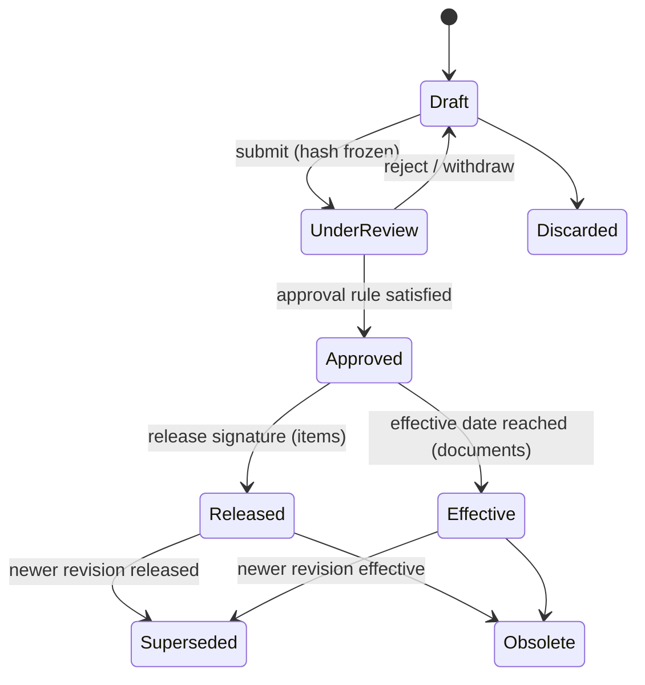

# 05 — Controlled Record / Revision, Audit and File-Storage Strategies

## 1. Controlled record and revision strategy

### 1.1 Generic revision state machine (items, documents)



Items additionally carry NRND/Prohibited as controlled lifecycle flags on released revisions (changing them requires signature, not a new revision).

### 1.2 Rules

| Rule | Mechanism |
|------|-----------|
| Only Draft is editable | service check + DB trigger |
| One open (Draft/Under Review) revision per record | partial unique index |
| New revision = copy of latest released revision into a new Draft | service; `supersedes_id` set |
| Content frozen at submission | `content_hash` computed; any edit returns to Draft and invalidates prior review signatures |
| Signatures bound to content | signature stores hash; mismatch blocks |
| Superseded revisions remain retrievable | never deleted; UI watermarks "SUPERSEDED" on views/PDFs [STD 4.2.4 f)] |
| Released revisions referenced by builds cannot be obsoleted without check | warn/block if open builds reference them |
| Change after first release requires ECO | release guard (doc 03 §9) |

### 1.3 Non-revisioned controlled objects

POs, builds, units, NCRs, lots, supplier approvals: state-machine controlled with signatures; their editable fields are frozen once past Draft; later changes are *amendments* (POs) or *corrective transactions* (inventory), never in-place edits.

## 2. Audit strategy

### 2.1 Two layers

| Layer | Captures | Why |
|-------|----------|-----|
| **Semantic audit** (`audit_event`), written by services | who/what/when/why, meaning, before/after of changed fields, related record, reason | Human-readable evidence for auditors |
| **Row-history backstop** (trigger on controlled tables → `row_history`) | Any row change at DB level, including changes that bypassed the service layer | Detects bypass (e.g. manual SQL) |

A row-history entry without a matching semantic audit event within the same transaction ID is flagged by a verification job as an **integrity finding**.

### 2.2 Append-only and tamper evidence

- `qplm_app` has only INSERT/SELECT on audit tables; triggers block UPDATE/DELETE for every role.
- Hash chain: `hash = SHA256(prev_hash || canonical_json(event))`. Inserts serialised through an advisory lock (throughput adequate: audit volume is human-scale).
- Chain head exported with every backup and daily to the log stream → an external anchor. Verification job walks the chain and reports the first break.
- Honest limit: a DB superuser can rewrite the table *and* recompute the chain; external anchors make that detectable. Superuser access is an [ORG] control.

### 2.3 What is audited

Create, modify (field diff), submit, sign, reject, release, obsolete, state change, upload, download (per document class setting), every stock transaction, login success/failure, logout, session revocation, password/MFA change, role/permission/signing-authority change, configuration change, integrity run, backup run, export of audit data.

Failed-login events are written in their own transaction (there is no business transaction to join).

### 2.4 Reason capture

Reason mandatory for: modifying anything past Draft (i.e. amendments), adjustments, scrap, quarantine, reversal, rejection, deactivation, config change. Reason codes + free text.

### 2.5 Access

Audit viewer with filters (date range, user, entity, action, record), CSV/PDF export (the export itself is audited). No edit/delete UI or API exists.

## 3. File-storage strategy

### 3.1 Layout (local)

```
/data/filestore/
  objects/sha256/ab/cd/abcd…ef   # content-addressed, mode 0440
  tmp/                           # upload staging, same filesystem
```

- Upload streamed to `tmp/` while hashing (SHA-256) and size-counting; size limit enforced during streaming.
- Validation: extension allow-list per document class; libmagic MIME detection must be consistent with extension; filename sanitised (NFC, strip path components/control chars, length cap); original filename kept in metadata only — never used as a path.
- Atomic `rename()` into `objects/` if the hash is new; if the hash exists, reuse (dedupe) — content cannot change under an existing key, so **overwrite is impossible by construction**.
- `file_object` + `attachment` rows committed in the same transaction as the record change. Orphan files (on disk, not in DB — e.g. crash between rename and commit) are reported by the integrity job, never auto-deleted.

### 3.2 Integrity verification

Job (manual or scheduled) re-hashes every object: results `OK`, `MISSING`, `SIZE_MISMATCH`, `HASH_MISMATCH`, `ORPHAN`. Findings stored, reported, audited. Quality reviews findings **[ORG]**.

### 3.3 Downloads

`Content-Disposition: attachment` with the controlled filename; `X-Content-Type-Options: nosniff`; SHA-256 in response header and UI so users can verify. Inline preview only for PDF/images via a sandboxed viewer; SVG never served inline from uploads (script risk) — previews are server-sanitised.

### 3.4 Retention

No deletion path in the application. Superseded/obsolete revisions remain with access restricted by permission.
